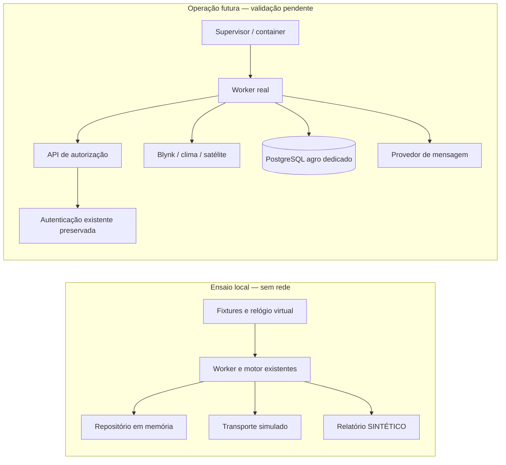

# ADR-0001 — Preparação operacional isolada do worker agro

## Estado

Aceito para implementação local no escopo autorizado em 8 de novembro de 2026. Implantação e promoção continuam pendentes de validação operacional do dono. O plano foi apresentado na conversa antes das alterações; nenhuma mudança na arquitetura principal é necessária.

## Contexto e requisitos

A Fase 1 separa identidade/autenticação, ingestão IoT, decisão agronômica, eventos do produtor e entrega técnica de notificações. A API Express mantém o login com Prisma legado; o worker usa `AgroRepository`/`pg` exclusivamente no PostgreSQL agro dedicado. A autorização atual vem de uma rota curta da API. O motor é puro; coleta, repositório, relógio e envio já são injetáveis em `createWorker`.

O dono quer adiantar preparação local antes da operação real. São requisitos: nenhum acesso a banco/API/dispositivo real, nenhum segredo lido, nenhuma migration aplicada, nenhum deploy, preservação absoluta do banco de login, padrão `agro-3`, nenhuma Fase 2–4. A infraestrutura ainda não está definida. Testes sintéticos não podem ser tratados como validação SQL ou agronômica.

## Avaliação da arquitetura

| Aspecto | Situação e consequência |
|---|---|
| Domínios | Identidade fica na API; worker possui ingestão, avaliação e entrega técnica agro. Não duplicar senhas ou sessão. |
| Dependências | Núcleo depende de regras/configuração pura; adaptadores reais dependem de HTTP e PostgreSQL. Ensaio substitui apenas as bordas. |
| Acoplamento | Autorização depende da disponibilidade da API antes de coletar/enviar; indisponibilidade bloqueia o uso de credenciais antigas. Manter esse limite. |
| Segurança | Contexto de container por lista explícita, sem schema/migrations/login; processo sem root; segredos só no ambiente dedicado de execução futura. |
| Escala/desempenho | Coleta sequencial e pool de duas conexões por processo. Medir duração/quotas antes de ampliar; não adicionar fila, cluster ou concorrência agora. |
| Manutenção | Mesmo lockfile e dependências existentes; sem segunda implementação do motor. Repositório em memória serve exclusivamente para ensaio e não emula garantias SQL. |

## Decisão

1. Acrescentar ensaio CLI separado, com cenários fixos identificados como sintéticos, relógio virtual, armazenamento descartável em memória e transporte simulado. Reutilizar o worker/motor existentes. Bloquear rede, importação dos adaptadores reais e leitura de `.env` nesse processo.
2. Acrescentar checagem de configuração do worker, pura e sem conectar. Mostrar apenas nomes/códigos de problema, nunca valores. Recusar configuração legada de autenticação no ambiente do worker. A checagem não prova isolamento físico do destino, TLS ou permissões.
3. Preparar Dockerfile e Compose opcionais, com usuário `node`, init, dependências do lockfile sem scripts de instalação, código por lista explícita e ambiente externo. Não construir imagem nem iniciar container nesta etapa. O daemon existente conserva seus handlers de SIGTERM/SIGINT.
4. Documentar roteiro de staging, evidências, critérios de interrupção, limitações e rollback. O empacotamento não aplica migrations nem inicia a API.

## Alternativas e trade-offs

- **Executar o daemon com credenciais reais em dry-run:** rejeitado; abre possibilidade de acesso indevido. Entrada offline separada permite bloquear os adaptadores antes de carregar o worker.
- **Somente testes unitários:** já existem; um ensaio executável facilita revisão operacional e gera resultados legíveis, ao custo de manter um adaptador de memória pequeno.
- **Banco local em container:** útil futuramente para SQL/locks, mas exige instalação/imagem e não é necessário para o ensaio sem serviços. Não fingir transações distribuídas em memória.
- **PM2/Kubernetes/fila nova:** complexidade e dependências injustificadas nesta escala. Compose é opcional e deixa o processo Node direto receber sinais pelo init.
- **Manifesto npm exclusivo do worker:** reduziria a imagem, mas criaria segundo lockfile e duplicaria gestão de dependências. Reusar lockfile atual implica carregar dependências de produção não usadas; não carregá-las no runtime. Reavaliar somente com evidência de custo.

## Implementação incremental, testes e rollback

Primeiro documentar e executar a suíte de base; depois ensaio com verificações de invariantes e configuração; por fim templates operacionais e roteiro. Testar sem rede heartbeat/duplicação, timestamps desconhecidos/antigos, lacunas do executor, investigação, isolamento por dispositivo, revogação e entrega incerta. Preservar os testes anteriores e executar `check:prisma`/build finais. A imagem e o Compose ficam explicitamente sem validação de execução enquanto Docker não estiver disponível.

Rollback local: remover os arquivos/scripts adicionados ou reverter seus commits. Não há mudança de schema ou de flags padrão. Rollback operacional futuro: parar o worker, retornar API a `agro-3` e manter as evidências agro; nunca alterar o banco de login, executar down migration ou reenviar automaticamente entregas incertas.

## Referências

- [Arquitetura e operação da Fase 1](../../MIGRACAO_AGRO4_FASE_1.md)
- [Decisões do dono](../decisoes-agro4-fase1.md)
- [Imagem Node: usuário sem root e init](https://github.com/nodejs/docker-node/blob/main/docs/BestPractices.md)
- [Contexto Docker e ignore específico](https://docs.docker.com/build/concepts/context/)
- [npm ci e ignore-scripts](https://docs.npmjs.com/cli/v11/commands/npm-ci/)
